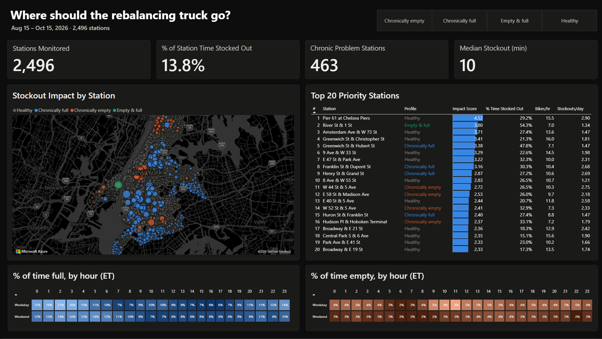
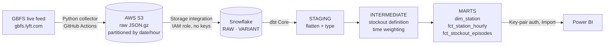
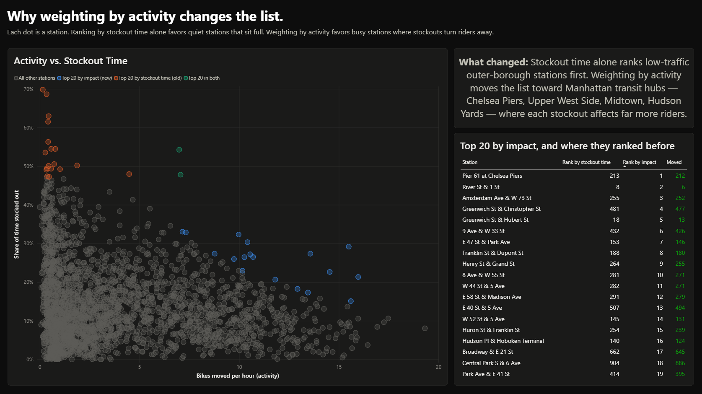

# Citi Bike Stockouts: Where Should the Truck Go?

Figuring out which Citi Bike stations fail riders the most, when it happens, and which ones a rebalancing truck should get to first. It's all built on 60+ days of live station data I collected myself, since nobody archives it.




---

## How this started

I've lived in New York City my whole life (22 years, though I guess it launched in 2013) and had never ridden a Citi Bike until recently. My friends and I always take the MTA when we hang out, but one day we decided to grab bikes and ride along Manhattan instead, which was a first for all of us.

It was fun, but it also showed me how the system actually works from the rider's side. When we went to return the bikes, the closest station was full, with no open docks, so we had to look up which nearby station still had space and ride over there. That made me curious: how often does this happen, where, and when?

If you've been around data science, you've probably seen or heard Citi Bike's trip history used in a lot of personal projects. This definitely scared me a bit from working on it, but I wanted something with real business impact rather than another take on the same dataset. More importantly, trip history can't answer my question. It only records rides that happened. If a station is full and you ride away to find another one, that failure never shows up anywhere.

So I used Citi Bike's live **GBFS feed** instead, which reports every station's bike and dock counts in real time. The catch is that it only shows the current moment and doesn't keep any history. To study stockouts over time, I had to build a pipeline that snapshots it every few minutes and saves everything.

---

## Architecture



| Layer | Tool | What it does |
|---|---|---|
| Ingest | Python, GitHub Actions | Fetches the feed, gzips the raw response untouched, and uploads it to S3 |
| Storage | AWS S3 | Raw landing zone, organized by date and hour |
| Warehouse | Snowflake | `COPY INTO` loads only new files; JSON stays raw until dbt parses it |
| Transform | dbt Core | Staging → intermediate → marts, with 26 data tests |
| BI | Power BI | Two pages: the priority map and ranking, and why activity matters |

---

## What I found

*Aug 15 – Oct 15, 2026 · 2,496 stations*

1. **13.8% of the time, a station is stocked out.** For about one in seven station-minutes, someone gets turned away, either with no bike to take or no dock to return to.

2. **Full is a bigger problem than empty.** On weekdays, stations are full the most around **2 AM (~17% of the time)**. Riding stops, and bikes sit wherever they were dropped off. Empty peaks mid-morning (**~6% at 10–11 AM**), after the commute drains residential stations. So the thing that happened to me and my friends is the more common failure.

3. **463 stations are chronically stocked out**, meaning empty or full at least 20% of the time.

4. **How you rank stations changes which ones get picked.** The most obvious way to rank them is by how often they're stocked out. But the top of that list is mostly quiet outer-borough stations that sit full because barely anyone rides there. When I weighted each station by how busy it is, the list moved to Manhattan transit hubs like Chelsea Piers, Penn Station, and Grand Central. **Only 2 stations appear in both top 20s.** The new #1, *Pier 61 at Chelsea Piers*, was **#213** by stockout time alone.

   To be clear, I don't know how Lyft actually prioritizes rebalancing, and it's probably a lot more sophisticated than either approach. This compares two ways of reading the data, not Lyft's operations.




**Priority score** = share of time stocked out × bikes moved per hour. A station that's full 60% of the time but moves 1 bike an hour affects fewer people than one that's stocked out 25% of the time and moves 15.

---

## Design decisions

**The raw data stays exactly as the API returned it.** The collector doesn't parse or clean anything. If I get something wrong downstream, I can rebuild from S3. The feed overwrites itself every minute, so there's no going back to re-collect.

**Timestamps come from my collector, not the feed.** Each file is stamped with the UTC time my code fetched it, and Snowflake reads that time from the filename.

**Every snapshot is weighted by time.** Some hours have 12 snapshots and some have 1 (see Limitations), so each snapshot counts for the minutes until the next one, capped at 15. All percentages are shares of observed time, not shares of rows.

**A stockout means zero bikes or zero docks at a station that's actually running.** About 80 stations in the feed are decommissioned or not deployed yet, and their zeros don't count.

**Fullness uses observed counts, not official capacity.** About 37% of stations don't add up to their listed capacity, so I use `bikes / (bikes + docks)` instead.

**Stockout durations only count when I saw them end.** Episodes are found with a gaps-and-islands query. Any episode that overlaps a gap in collection gets flagged and left out of the duration stats, instead of being reported as a made-up 15 minutes.

**I stayed on GBFS 1.1.** Lyft also publishes 2.3. I looked into switching, but 1.1 already gives the e-bike split I needed, and switching would have broken the format of weeks of data I'd already collected.

**No passwords or long-lived keys anywhere.**
- Snowflake reads from S3 by assuming a read-only AWS role that only covers the raw folder.
- dbt and Power BI log in to Snowflake with key-pair authentication.
- The collector's AWS keys only exist in GitHub secrets.

**Costs are capped.** The smallest warehouse that auto-suspends after 60 seconds, a resource monitor that shuts it off at 10 credits a month, incremental dbt models, and Power BI in Import mode so viewing the report doesn't run Snowflake.

---

## Data quality

26 dbt tests run on every build, including:
- No nulls or duplicates in key columns; station profile and stockout type only take expected values
- **E-bikes never exceed total bikes**, which confirms that classic bikes = bikes − e-bikes
- No negative counts, and every percentage between 0 and 1
- Exactly one row per station × hour × weekday/weekend
- A freshness check that warns if the newest snapshot is more than 2 days old

---

## Limitations

- **GitHub Actions cron is very inconsistent.** I scheduled the collector every 15 minutes, and GitHub just didn't run it most of the time. Some hours got several snapshots, some got one, and some got skipped completely. Every run showed a green check, so it wasn't failing. GitHub was quietly not running it. Switching to one trigger an hour that takes 12 snapshots in a loop helped a lot, but gaps still happen. I stuck with Actions because it's free, I wanted to learn it, and it's something I've wondered how it works. But yeah, this was very inconsistent. 
- **Single-station weekend numbers are noisy.** Two months only contains about 9 weekends, and some of those had collection gaps. When you click one station, a weekend hour might rest on just a few snapshots. A 0% there means the station was never full in the snapshots I have, not that it never fills up. A blank cell means no data at all.
- **Activity is a rough approximation.** It's the net change in bike count between snapshots, so a rental and a return in the same window cancel out, and rebalancing trucks count too. It's good for comparing stations, not for counting rides.
- **Durations are in 5-minute steps**, since that's how often I sampled. The median stockout of 10 minutes is only accurate to that.
- **The 20% "chronic" cutoff and the 7-day minimum for ranking are my judgment calls**, not derived from anything.
- The feed includes **Jersey City and Hoboken**, which are part of the Citi Bike system.

---

## Repository layout

```
.github/workflows/collect.yml   Scheduled collector (hourly trigger, 12 snapshots per run)
ingest/collect_gbfs.py          Fetch → gzip → S3, with retries and fail-loud exit codes
snowflake/setup.sql             Warehouse, S3 integration, stage, raw tables, COPY INTO
citibike_dbt/                   dbt project: staging, intermediate, marts, tests
powerbi/                        Report (.pbix) and theme
docs/                           Screenshots
```

---

## Takeaways
Honestly, there was so much I learned going through this project and a lot of it is thanks to AI (Claude). Now I don't want to list out everything as its 3am at the time I am writing this, but also because theres so much, but one of the biggest thing I learned and honestly is expected is how much verification and security stands between you and your own data on cloud platforms, even for a personal project. IAM roles and trust policies, external IDs, key pairs instead of passwords, secrets kept out of the code. Theres just a lot of security, which again makes total sense, but since this was just for a personal project, I wonder how it works in a company environment.

---

## Running it

```bash
# 1. The collector runs on its own through GitHub Actions (secrets: AWS keys, S3_BUCKET)
# 2. Load new snapshots: run the COPY INTO statements in snowflake/setup.sql
# 3. Transform and test
cd citibike_dbt && dbt build
# 4. Refresh the Power BI report
```
